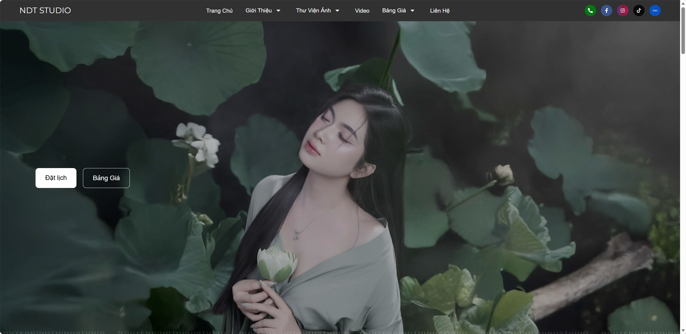
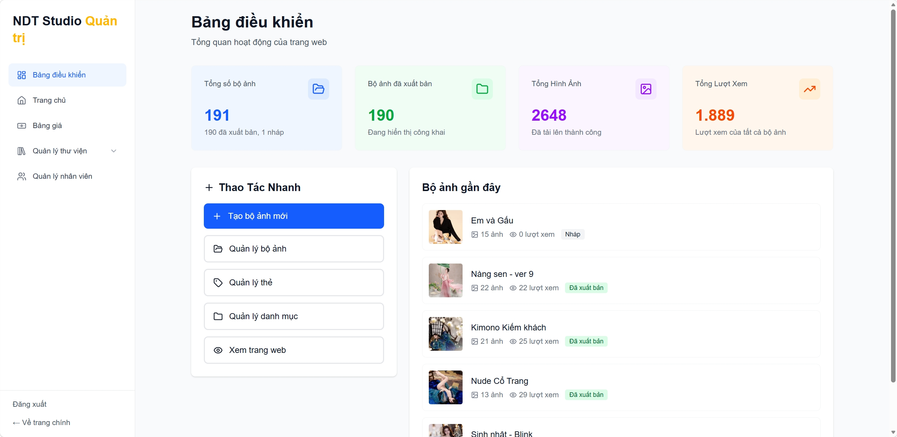
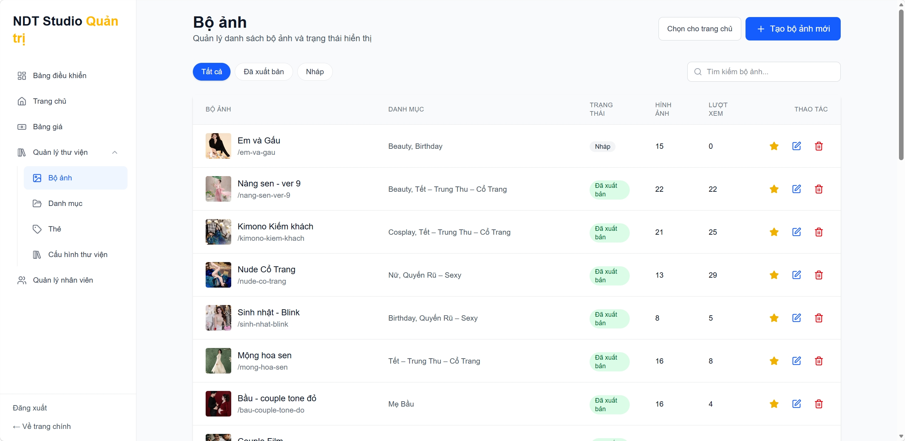
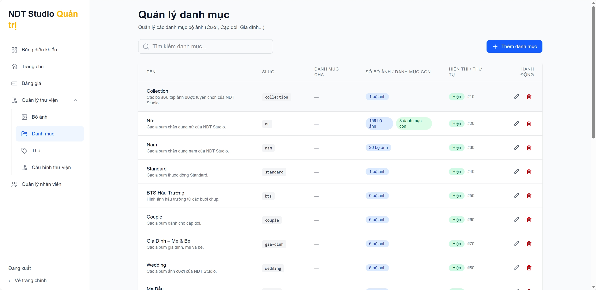
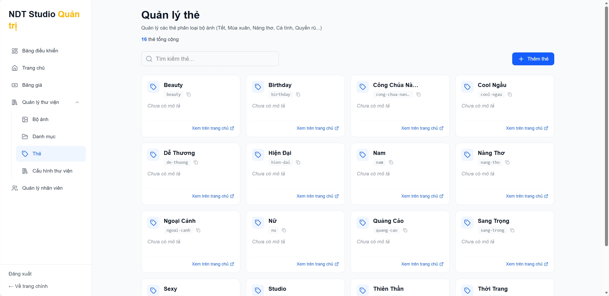
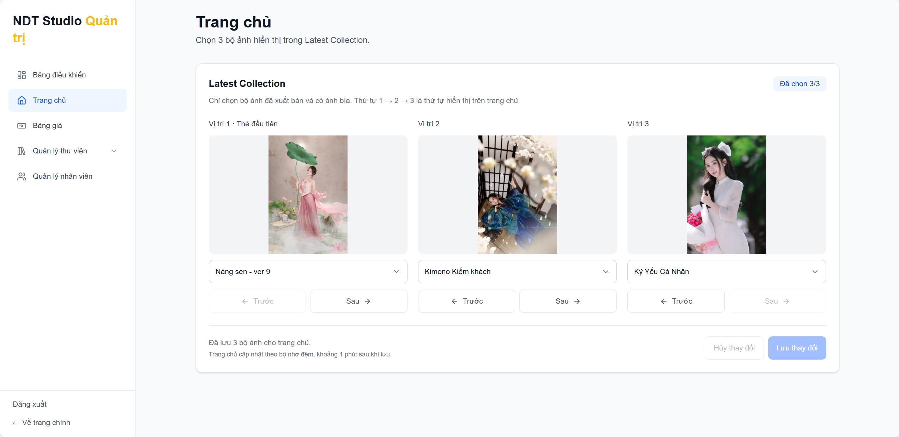
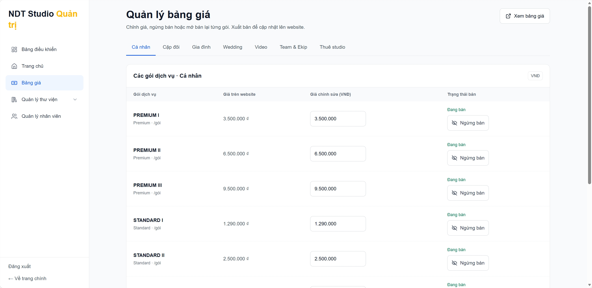

# Nguyễn Đình Thịnh Studio

**Website và hệ thống quản trị cho studio nhiếp ảnh tại Nha Trang.**

[Website](https://ndtstudio.com.vn/) · [Thư viện ảnh](https://ndtstudio.com.vn/thu-vien) · [Bảng giá](https://ndtstudio.com.vn/bang-gia) · [Liên hệ](https://ndtstudio.com.vn/lien-he)

[](https://ndtstudio.com.vn/)

## Giới thiệu

Khách hàng có thể khám phá bộ ảnh theo danh mục và thẻ, tìm ý tưởng cho buổi chụp, xem video và bảng giá dịch vụ, rồi liên hệ đặt lịch.

Đội ngũ studio dùng cổng quản trị để tạo bản nháp và xuất bản bộ ảnh, sắp xếp các bộ ảnh nổi bật trên trang chủ, cập nhật giá và trạng thái mở bán, đồng thời quản lý hồ sơ nhân viên.

## Giao diện quản trị



<details>
<summary>Xem thêm các màn hình quản trị</summary>

**Bộ ảnh**



**Danh mục**



**Thẻ**



**Bộ ảnh nổi bật trên trang chủ**



**Bảng giá**



</details>

## Kiến trúc

Dự án dùng npm workspaces và Turborepo để quản lý frontend, API và các gói dùng chung.

| Thành phần                             | Công nghệ và vai trò                                                                  |
| -------------------------------------- | ------------------------------------------------------------------------------------- |
| [Frontend](./apps/frontend)            | Next.js, React, TypeScript và Tailwind CSS cho website và cổng quản trị.              |
| [Backend](./apps/backend)              | NestJS và Swagger cho API thư viện, bảng giá và quản trị.                             |
| [Cơ sở dữ liệu](./apps/backend/prisma) | PostgreSQL trên Supabase, truy cập qua Prisma.                                        |
| Xác thực                               | Supabase Auth, với quyền quản trị được kiểm tra qua JWT.                              |
| Hình ảnh                               | Cloudflare R2 lưu trữ ảnh và imgproxy tạo các phiên bản ảnh theo kích thước hiển thị. |
| [Gói dùng chung](./packages)           | Kiểu dữ liệu, tiện ích và chính sách tải ảnh.                                         |

## Chạy trên máy phát triển

Chuẩn bị Node.js 24, npm 11, một dự án Supabase dành cho phát triển, bucket Cloudflare R2 và dịch vụ imgproxy.

```bash
git clone https://github.com/ngxtm/nguyendinhthinhstudio.git
cd nguyendinhthinhstudio
npm ci
cp .env.example apps/backend/.env
```

Trong `apps/backend/.env`, điền `DATABASE_URL`, `DIRECT_URL`, thông tin Supabase, R2 và imgproxy theo môi trường phát triển. Mẫu [`.env.example`](./.env.example) cần bổ sung cấu hình JWT và tải ảnh bên dưới. Thay các giá trị có dấu `<>` bằng giá trị tương ứng.

<details>
<summary>Cấu hình bổ sung cho backend</summary>

```dotenv
NODE_ENV=development
PORT=3000
ALLOWED_ORIGINS=http://localhost:3001
IMAGE_DELIVERY_MODE=imgproxy

SUPABASE_JWT_MODE=asymmetric
SUPABASE_JWT_ISSUER=https://<project-ref>.supabase.co/auth/v1
SUPABASE_JWT_AUDIENCE=authenticated
SUPABASE_JWKS_URL=https://<project-ref>.supabase.co/auth/v1/.well-known/jwks.json
SUPABASE_JWT_ALGORITHMS=ES256,RS256
SUPABASE_JWT_SECRET=

IMAGE_UPLOAD_PROCESS_ROLE=api
IMAGE_UPLOAD_PROCESS_COUNT=1
IMAGE_UPLOAD_DECODE_PERMITS_PER_PROCESS=2
IMAGE_UPLOAD_R2_CONTROL_TIMEOUT_SECONDS=30
IMAGE_UPLOAD_R2_READ_TIMEOUT_SECONDS=60
IMAGE_UPLOAD_PRESIGN_ENABLED=false
IMAGE_UPLOAD_INGRESS_MODE=disabled
IMAGE_UPLOAD_PRESIGN_CLOCK_SKEW_SECONDS=60
IMAGE_UPLOAD_RATE_LIMIT_CLEANUP_BATCH=1000
IMAGE_UPLOAD_CANONICAL_PREFIX=albums/
IMAGE_UPLOAD_TRUSTED_PROXY_ALLOWLIST=127.0.0.1,::1
IMAGE_UPLOAD_R2_ENDPOINT=<giá trị R2_S3_ENDPOINT>
IMAGE_UPLOAD_R2_BUCKET=<giá trị CLOUDFLARE_R2_BUCKET_NAME>
IMAGE_UPLOAD_API_R2_ACCESS_KEY_ID=<giá trị R2_ACCESS_KEY_ID>
IMAGE_UPLOAD_API_R2_SECRET_ACCESS_KEY=<giá trị R2_SECRET_ACCESS_KEY>
```

Thiết lập trên dùng khóa ký JWT bất đối xứng của Supabase và tắt cấp URL tải ảnh trong môi trường phát triển. `IMGPROXY_KEY` và `IMGPROXY_SALT` phải là chuỗi hex khớp với cấu hình dịch vụ imgproxy.

</details>

Tạo `apps/frontend/.env.local` với URL và khóa anon của cùng dự án Supabase.

```dotenv
NEXT_PUBLIC_API_URL=http://localhost:3000
NEXT_PUBLIC_ADMIN_API_ORIGINS=http://localhost:3000
NEXT_PUBLIC_SUPABASE_URL=https://<project-ref>.supabase.co
NEXT_PUBLIC_SUPABASE_ANON_KEY=<supabase-anon-key>
```

Áp dụng migration vào cơ sở dữ liệu phát triển rồi khởi động cả hai ứng dụng.

```bash
npm run migrate:deploy --workspace=backend
npm run dev
```

- **Website** · [localhost:3001](http://localhost:3001)
- **Quản trị** · [localhost:3001/admin](http://localhost:3001/admin). Đăng nhập bằng tài khoản được cấp quyền `admin` qua [Supabase Auth Hook](./docs/superpowers/specs/2026-07-15-admin-supabase-rbac-design.md).
- **Swagger** · [localhost:3000/api](http://localhost:3000/api)

## Tài liệu kỹ thuật

- [Quy trình triển khai Prisma migrations](./docs/deployment/prisma-migrations.md)
- [Quản lý và xuất bản bảng giá](./docs/features/admin-pricing.md)
- [Cấu hình điều hướng thư viện ảnh](./docs/adr/0003-database-owned-public-gallery-navigation.md)

## Giấy phép

[Apache License 2.0](./LICENSE.md)
